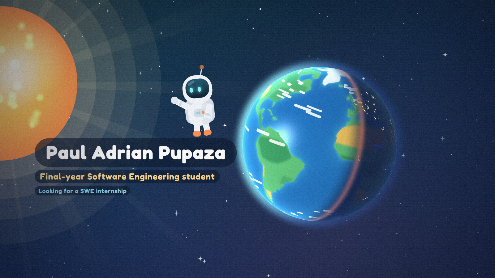
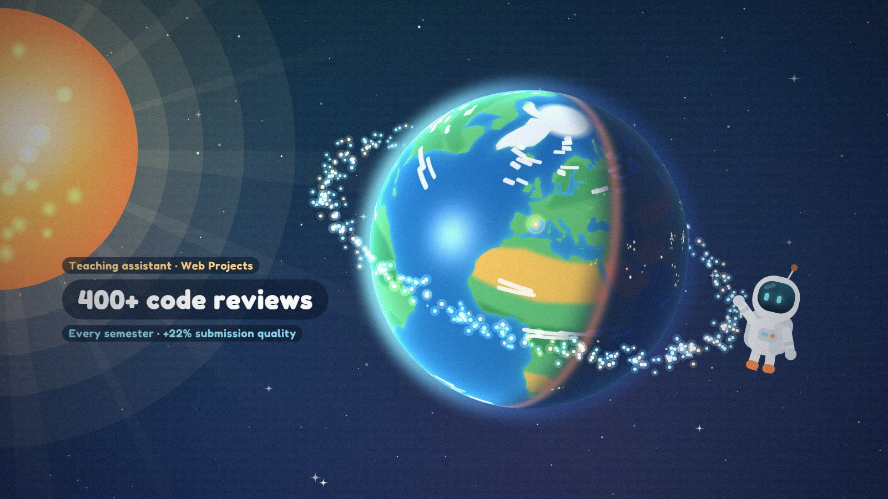
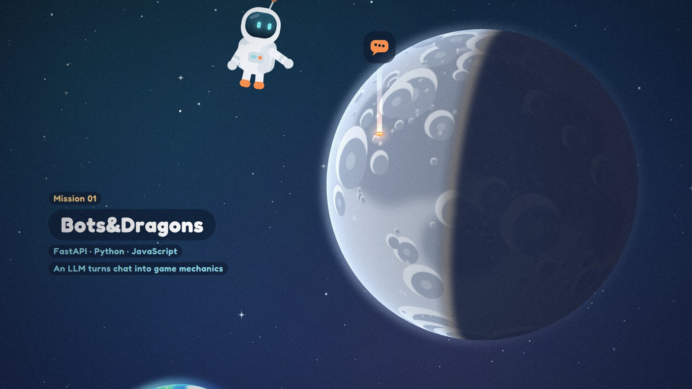
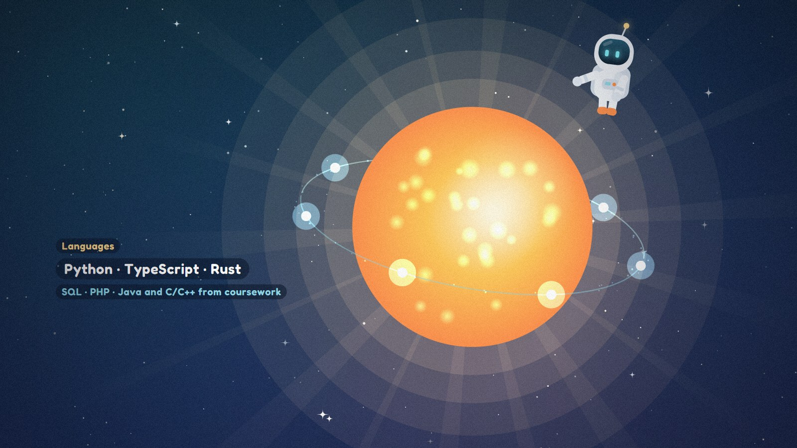
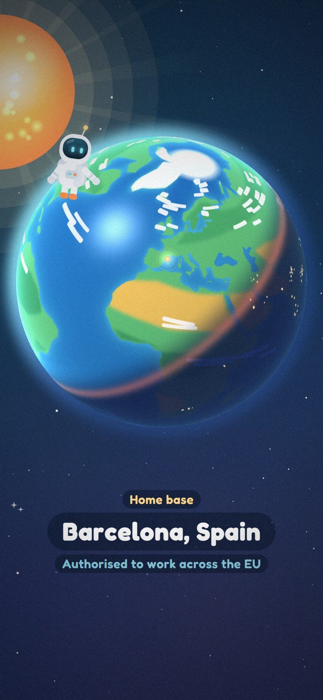
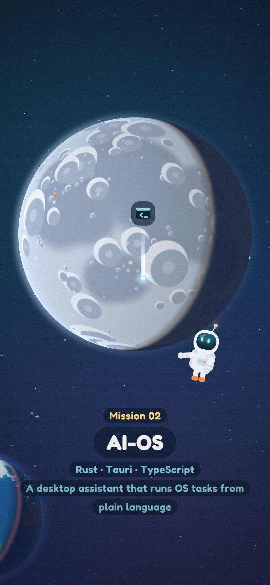
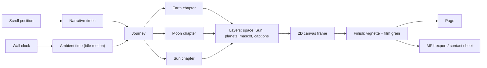

<div align="center">

# Paul Adrian Pupaza · Portfolio

**A scroll-driven journey from the Earth to the Moon to the Sun, drawn entirely in code.**

[](https://paulpupaza.dev)
[](https://nextjs.org)
[](https://www.typescriptlang.org)
[](https://vercel.com)



</div>

## About

This is my personal portfolio as a final-year Software Engineering student at La Salle BCN (Barcelona). Instead of a static page, the site tells my story as a trip through space that advances as you scroll:

| Chapter | What it covers | What happens on screen |
| --- | --- | --- |
| 🌍 **Earth** | Who I am, where I study, teaching, languages | The globe turns to Barcelona, 400 "code review" satellites orbit the planet, arcs link the places whose languages I speak |
| 🌙 **Moon** | My projects | The Moon waxes as you scroll, and each new phase lights up a beacon for one project, with a link to its code |
| ☀️ **Sun** | My skills | Four orbits trace in one by one, one per skill group, before a dive into the light and a closing call to action |

Below the story there is an FAQ for recruiters and the contact links. The whole site is available in **English and Spanish**.

## Screenshots

<table>
  <tr>
    <td width="50%"></td>
    <td width="50%"></td>
  </tr>
  <tr>
    <td><sub>Teaching: one orbiting satellite per reviewed submission</sub></td>
    <td><sub>Projects: each lunar phase lights one mission</sub></td>
  </tr>
  <tr>
    <td width="50%"></td>
    <td width="50%">
      
      
    </td>
  </tr>
  <tr>
    <td><sub>Skills: one orbit per group, one orb per skill</sub></td>
    <td><sub>Same story on phones, reframed for portrait</sub></td>
  </tr>
</table>

## Highlights

- **Every frame is a function of time.** Each scene is a pure `draw(t)`. Scrolling maps the page position to `t`, so any moment can be rendered again with exactly the same result, which also makes the animation easy to test and export.
- **Drawn in code, no image assets.** Space, stars, the Sun, the astronaut and all captions are drawn on a 2D canvas. The Earth and the Moon are orthographic spheres shaded in WebGL fragment shaders, with maps painted at start-up from longitude/latitude polygons.
- **Works everywhere.** Planets render with WebGL2, fall back to WebGL1, and then to a flat canvas-2D version, so the animation still plays on older phones. If the canvas cannot run at all, a plain-text version of the content is shown instead.
- **Built-in studio** (development only): scrub to any moment, generate a contact sheet of every scene for desktop and mobile, export the whole journey as a 1080p30 MP4 with motion blur (WebCodecs), and render the social share image and these screenshots from real frames.
- **Recruiter friendly.** Name, role and contact buttons are visible on the first frame. Chapter navigation, FAQ, CV download and links to each project's code are always one click away.
- **Accessible.** Real HTML headings and text for screen readers and search engines, keyboard-friendly controls, 44px touch targets, and reduced-motion support.
- **Bilingual.** `/en` and `/es` routes, chosen automatically from the browser language.

## Tech stack

| Area | Tools |
| --- | --- |
| Framework | Next.js 16 (App Router, static generation), React 19, TypeScript |
| Graphics | Canvas 2D, WebGL2 / WebGL1 (GLSL shaders), a small custom animation engine |
| Video export | WebCodecs + [`mp4-muxer`](https://github.com/Vanilagy/mp4-muxer) |
| Styling | CSS Modules, Fredoka via `next/font` |
| Hosting | Vercel, custom domain [paulpupaza.dev](https://paulpupaza.dev) |

## How it works



1. The page maps scroll progress to a narrative time `t`. Big jumps (chapter links, reloads) cut straight to the target instead of replaying the way there.
2. The `Journey` places the three chapters on one timeline and dissolves each into the next.
3. Each chapter samples keyframe tracks (camera, poses, light) at `t` and draws its layers. Planets are shaded in their own WebGL canvas and composited into the 2D frame.
4. The same renderer drives the live page, the contact sheet and the video export, so all three always match.

## Project structure

```
src/
├── app/                 Routes: /[locale] (page, studio), share images, icon
├── components/          StoryCanvas, SiteHeader, Faq, Studio
├── content/             Contact, CV and project links in one place
├── engine/
│   ├── core/            Renderer, view/camera, keyframe tracks, math, text
│   ├── layers/          Space, Sun, captions, astronaut, Earth & Moon shaders
│   ├── story/           Earth, Moon and Sun chapters and the Journey
│   └── export/          Contact sheet and MP4 export
└── i18n/                English and Spanish copy
```

## Running locally

Requires Node.js 20.9 or newer.

```bash
npm install
npm run dev
```

Then open [http://localhost:3000](http://localhost:3000). The studio lives at [http://localhost:3000/en/studio](http://localhost:3000/en/studio) and is only available in development.

Other commands:

```bash
npm run build   # production build
npm run lint    # ESLint
```

Useful for testing fallbacks on any device: `?renderer=webgl1` or `?renderer=2d` forces the WebGL1 or canvas-2D planets.

## Art direction

The look is inspired by the flat, colourful style of science explainer animations: no outlines, soft glows, film grain and rounded caption pills. All artwork is original and drawn in code. There are no AI-generated images and no third-party characters.

## Contact

- 🌐 [paulpupaza.dev](https://paulpupaza.dev)
- 💼 [LinkedIn](https://www.linkedin.com/in/paul-adrian-pupaza)
- ✉️ [paulpupaza004@gmail.com](mailto:paulpupaza004@gmail.com)

<sub>© Paul Adrian Pupaza</sub>
